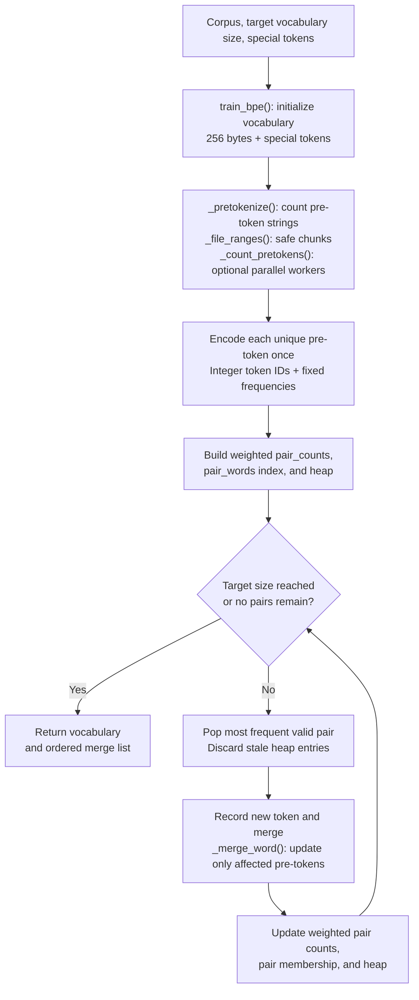

## Preliminaries

- My repository forked from the course: [https://github.com/zhenduowen/cs336-assignment1-basics](https://github.com/zhenduowen/cs336-assignment1-basics)

- <a href="{{ site.baseurl }}/assets/files/notes/cs336_spring2025_assignment1_basics.pdf">The problem descriptions for Assignment 1 can also be found within this Blog.</a>

- For setting up a local environment, [another post]({{ site.baseurl }}/posts/windows-sub-linux/) may be useful.

- This project's dependencies are managed by `uv`. To use `uv` to set up dependencies locally:
    ```terminal
    # Navigate to the cloned repository
    cd your-repo-name

    # Install dependencies from pyproject.toml
    uv sync

    # Activate the virtual environment created by uv
    source .venv/bin/activate  # On Unix/macOS
    # OR
    .venv\Scripts\activate     # On Windows
    ```
`uv sync` creates a local environment for this particular project and then installs dependencies according to `pyproject.toml`.

An additional file, `uv.lock`, records the exact dependency versions that should be installed. This file usually imposes stricter version requirements than `pyproject.toml`.

For further reading about the features of `uv`, see [https://docs.astral.sh/uv/getting-started/features/#projects](https://docs.astral.sh/uv/getting-started/features/#projects).

**Local hardware.** This project runs on an AMD Ryzen 7 9700X CPU (8 cores, 16 threads) and an NVIDIA GeForce RTX 5070 Ti GPU (approximately 16 GiB of VRAM), using Ubuntu 24.04 LTS under WSL2. The WSL environment exposes approximately 15.2 GiB of RAM and 4 GiB of swap. Our BPE training experiments run on the CPU, using four worker processes for pre-tokenization.

## Overview of the Assignment

- `/cs336_basics/` is where we write all the implementations.
- `/tests/` includes all the unit tests, and `adapters.py` connects these unit tests with our implementations in `/cs336_basics/`. `pyproject.toml` is the `uv` project file that contains all the dependencies needed for this project. To run the tests, first use `uv` to set up the dependencies, and then run `uv run pytest`. If a corresponding unit has not been implemented, a `NotImplementedError` will be raised.
- Create a `/data/` folder. `TinyStoriesV2-GPT4.txt` (training and validation) can be found [here](https://huggingface.co/datasets/roneneldan/TinyStories/tree/main), and `owt.txt` (training and validation) can be found [here](https://huggingface.co/datasets/stanford-cs336/owt-sample/tree/main). Download the datasets to `/data/`. Add this folder to `.gitignore` so that Git ignores the datasets.

I am following the spring 2025 version of assignment 1.

## Byte-Pair Encoding Tokenizer

### Unicode Standard and UTF-8 Encoding

#### Intro and Example
Unicode Standard gives every character a unique number called **code point**.

```plain
A        → U+0041
中       → U+4E2D
😊       → U+1F60A
```
But it is not practical to train tokenizers on Unicode code points, the vocabulary would be too large (roughly 150K items in it) and sparse (a lot of rare characters). This is why `UTF-8` encoding was introduced:

`UTF-8` is an encoding method on Unicode code points as bytes. The `8` stands for 1 byte which is 8 bits. The Unicode standard itself defines three encodings: `UTF-8`, `UTF-16`, and `UTF-32`. `UTF-8` is the most prevailing encoding for the Internet, used roughly in over 98% of web pages.

```python
In [9]: test_string = "I 我"

In [10]: utf8_encoded = test_string.encode('utf-8')

In [11]: utf8_encoded
Out[11]: b'I \xe6\x88\x91'
```

In `b'I \xe6\x88\x91'`, the prefix `b` means it is a sequence of raw bytes in Python. After UTF-8 encoding:
```plain
I      → 0x49
space  → 0x20
我     → 0xe6 0x88 0x91
```
Since each byte value is an integer range 0 to 255, the number of codepoints are 154997. 

#### prefix-free and self-synchronizing
A code point could take multiple bytes after encoding, like `我 : 0xe6 0x88 0x91`. UTF-8 is **prefix-free** and **self-synchronizing**. Self-synchronizing means that even if one start reading a UTF-8 byte sequence from the middle, one can still recover the correct character boundaries. And prefix-free means that no encoding is the prefix of some other encodings. The following example explains these in details:
```plain
0xxxxxxx   = 1-byte character (for ASCII)
110xxxxx   = start of a 2-byte character
1110xxxx   = start of a 3-byte character
11110xxx   = start of a 4-byte character
10xxxxxx   = continuation byte
```
Observe that starting bytes never start with `10` and continuation bytes always start with `10`. So if the stream is corrupted and we start in the middle, any byte start with `10` is a continuation byte and we can move on, till we find a starting byte.

Note that Python displays printable ASCII directly:
```plain
0x49 → I
0x20 → space
```
The byte `\xe6` means it is a hexdecimal value is `e6`. So the actual UTF-8 encoding is `49 20 e6 88 91`.

The UTF-8 encoding helps us to focus on byte values which only range within 0 to 255. 

Now a quick summary. The advantages of UTF-8 over UTF 16 and UTF 32 are:
- Compact:
  ```plain
    Character    UTF-8 bytes              UTF-16 bytes        UTF-32 bytes

    I            49                       49 00               49 00 00 00
    space        20                       20 00               20 00 00 00
    我           e6 88 91                 11 62               11 62 00 00
  ```
- ACSII-compatible:
  ```plain
  A → 0x41
  B → 0x42
  space → 0x20
  ```
  English text remains readable at the byte level.
- UTF-8 gives a universal vocabulary of size 256.
Also, note that most training data is already stored in UTF-8.

### Subword Tokenization

#### Intro

Although byte-level tokenization can alleviate the issue of out-of-vocabulary, tokenizing texts by character results in extremely long input sequences. For example, a sentence with 10 words may only be 10 tokens in a word-level language model, but could be 50 or more tokens in a character-level model. 

Subword tokenization is designed to balance such a mismatch. For character level tokenization, byte vocabulary has size 256. A subword tokenizer trades off a larger vocabulary size for better compressing the length of the input bytes sequence. For example, it would be good to add a particular token in the vocabulary for the word "the".

To achieve such a scheme, [Sennrich et al [2016]](https://aclanthology.org/P16-1162/) propose to use byte-pair encoding (BPE). This algorithm iteratively *merges the most frequent pair of bytes with a new unused index*. Tokenizers constructed in such a scheme are called **BPE tokenizers**. The process of building the BPE tokenizer vocabulary is call "training" the BPE tokenizer.

#### Training BPE Tokenizers

The training procedure consists of three steps:
- **Initialization** The tokenizer vocabulary is a bijective mapping from bytestring token to integer ID. For byte level BPE tokenizer, the initial vocabulary is simply the set of all 256 bytes. It contains all possible single-byte values. 
  - A byte have 256 possible values: `0x00, 0x01, ..., 0x7F, 0x80, ..., 0xFF` The ASCII compatible part is `0x00 to 0x7F`, which is 128 values contains English letters, digits, punctuations, spaces, newline, and control characters. The remaining byte values `0x80 to 0xFF` are not ASCII characters by themselves. In UTF-8 they are used as part of multi-byte encodings for non-ASCII characters. For example, `我 → e6 88 91`.
  - **Special tokens** Often, some strings like `<|endoftext|>` are used to encode metadata like boundaries between files. These special tokens should never be split into multiple tokens. Special tokens are often added to the vocabulary in the initialization.
- **Pre-tokenization** Going through the entire text corpus each time we want to merge some bytes can be computationally expensive. Also, directly merging tokens across the corpus may result in tokens that differ only in punctuation, as BPE merges frequent adjacent byte pairs purely by frequency, not by semantic meaning. For example, suppose the corpus contains many examples like:
    ```plain
    dog.
    dog!
    dog?
    ```
    If we directly run BPE over the whole byte stream, the algorithm may see these frequent adjacent pairs:
    ```plain
    d o
    do g
    dog .
    dog !
    dog ?
    ```
    These are different byte strings, so they receive different token IDs:
    ```plain
    "dog." → token ID 1057
    "dog!" → token ID 3092
    "dog?" → token ID 8271
    ```
    To avoid this, we *pre-tokenize* the corpus by manually splitting the text into meaningful pieces. A naive approach can be splitting by spaces, like `I love dogs!` to `["I", " love", "dogs", "!"]`. 
    
    Pre-tokenization also improves efficiency in a simple way. Suppose the word `dogs` appear 10 times, we can directly add character pair frequence with `(d,o) += 10, (o,g) += 10, (g,s) += 10`, which makes character pairs counting more efficient.

    In GPT-2 (and in this assignment), regex-based pre-tokenizer is applied. See [Radford et al., 2019](https://cdn.openai.com/better-language-models/language_models_are_unsupervised_multitask_learners.pdf) from `github.com/openai/tiktoken/pull/234/files:`
    ```python
    # split by contractions | words | numbers | punctuation | trailing spaces | other spaces
    PAT = r"""'(?:[sdmt]|ll|ve|re)| ?\p{L}+| ?\p{N}+| ?[^\s\p{L}\p{N}]+|\s+(?!\S)|\s+"""
    ```

- **Compute BPE Merges** After splitting text into pre-tokens, each pre-token is represented as a sequence of UTF-8 Bytes. The BPE Algorithm then iteratively counts every pair of bytes, merges the most frequent pairs, and add to the vocabulary.

    - We **do not consider pairs across the pre-token boundaries**. If we broke `dog.` into `dog` + `.` in pre-tokenization, then such a scheme means that `g` will never merge with the `.`. And when `dog` appear enough times, this word will be added to the vocabulary.

### Experimenting with BPE Tokenizer Training

Now we train a byte-level BPE tokenizer on the [TinySories dataset](https://huggingface.co/datasets/roneneldan/TinyStories). For local tests, use the validation set for debugging.

#### General suggestions for implementation
Before jumping into implementation, a few things to keep in mind:
- **Profiling** Use profiling tools to identify the bottlenecks in our implementation. For this assignment, built-in deterministic profiler `cProfile` is recommended.
- **Parallelizing pre-tokenization** A major bottleneck is the pre-tokenization step. We can chuck the corpus by the location of the special token indicating end of the document (the chunking is always valid, as we never want to merge across document boundaries), and use the built-in library `multiprocessing`. The chunking does not need to be perfect and there will be edge cases of receiving a very large corpus that does not contain `<|endoftext|>`.
- **Remove special token before pre-tokenization** Before running pre-tokenization with the regex pattern, we should strip out all special tokens from the corpus. For example, if you have a corpus (or chunk) like `[Doc 1]<|endoftext|>[Doc 2]`, you should split on the special token `<|endoftext|>`, and pre-tokenize `[Doc 1]` and `[Doc 2]` separately, so that no merging can occur across the document boundary.
    > A naive idea to split by `<|endoftext|>` is to use `parts = re.split("<|endoftext|>", text)`. But this is **wrong** because in regex, `|` means OR. The regex pattern `<|endoftext|>` means (roughly) `< OR endoftext OR >`, it says here may split on `<`, `endoftext`, or `>` separately. To treat the special token literally, use `re.escape`:

    ```python
    import re

    text = "[Doc 1]<|endoftext|>[Doc 2]"
    special_tokens = ["<|endoftext|>", "<|pad|>"]

    escaped_tokens = [re.escape(tok) for tok in special_tokens] # | is escaped
    delimiter = "|".join(escaped_tokens) # here "|" means OR, combine multiple escaped tokens into one regex pattern.

    parts = re.split(delimiter, text)
    print(parts)
    ```
- **Adaptive merging** A naive implementation of BPE training iterates over all byte pairs to identify the most frequent pair. Note that the only pair counts changes after each merge are those that overlap with the merged pair. This is also why this merging step cannot be easily parallelized: Thread 2's work is depended on the result of Thread 1's work.
  > A remark here is that in CPython, the standard Python implementation, there is **Global Interpreter Lock(GIL)**. It means that, within one Python process, only one thread at a time is allowed to execute Python bytecode. Conceptually, even if we create four threads, the GIL means that they take turns to executing Python bytecode.

#### Python implementation details


**Main implementation scheme**

In `cs336_basics/bpe_tokenizer.py`, training starts with the 256 byte tokens and special tokens. We split text around special tokens, apply the pre-tokenization regex, and count repeated pre-tokens. Each distinct pre-token becomes a sequence of integer token IDs with a fixed frequency. We then repeatedly select the most frequent adjacent pair, merge its occurrences, and update the vocabulary and pair statistics until the target vocabulary size is reached or no pairs remain.

The entry point, `train_bpe(input_path, vocab_size, special_tokens)`, returns an ID-to-bytes vocabulary and an ordered list of byte-pair merges; optional `num_workers` and `chunk_size` arguments control preprocessing. Internally, `_pretokenize()` coordinates counting: `_file_ranges()` finds safe chunk boundaries, and `_count_pretokens()` counts regex pre-tokens within each chunk. During training, `_merge_word()` applies the chosen pair to one sequence using non-overlapping, left-to-right replacements, while `train_bpe()` maintains the global pair counts and heap.

**Tricks that improve performance**

The naive trainer in `cs336_basics/naive_bpe_tokenizer.py` already groups repeated pre-tokens, but scans every stored sequence and recounts all pairs after each merge. We reduce this repeated work through four changes:

- **Incremental updates:** `pair_counts` stores weighted pair frequencies, while `pair_words` maps each pair to the pre-tokens containing it. Only affected sequences are merged and recounted, updating each pair by `(after - before) * pretoken_frequency`.
- **Heap selection:** A heap replaces the full `max()` scan over pair counts. Updated counts create new entries; outdated entries are discarded when popped. Frequency ties still select the lexicographically largest pair of byte spellings, preserving the required merge order.
- **Less repeated conversion:** Count pre-token strings before encoding, so each distinct string is UTF-8 encoded once. Integer IDs let sequences reuse vocabulary entries instead of repeatedly constructing merged byte strings.
- **Parallel preprocessing:** Optional worker processes count pre-tokens in chunks ending at special-token boundaries. Generators and a bounded number of pending jobs limit temporary allocations. Merge decisions remain sequential because each depends on the previous one.

**Profiling evidence**

On Python 3.12.12 under Linux/WSL2, we compared identical inputs and settings with one preprocessing worker. The table reports medians of three unprofiled runs after warmup, with warm filesystem caches. Both implementations produced identical vocabularies and ordered merge lists on these workloads.

| Input | Vocabulary size | Naive | Optimized | Speedup |
| --- | ---: | ---: | ---: | ---: |
| `corpus.en` (~130 KiB) | 500 | 1.140 s | 0.080 s | 14.3× |
| TinyStories sample (5 MiB) | 1,000 | 6.156 s | 0.393 s | 15.7× |
| TinyStories validation (21.46 MiB) | 10,000 | 80.740 s | 1.473 s | **54.8×** |

Separate `cProfile` runs on the validation workload show why: word-merge calls fell from **127.7 million to 68,766**, encoding calls from **5.42 million to 13,114**, and all **9,743 global pair recounts** were replaced by local updates. Preprocessing now accounts for about **75%** of optimized profiled runtime.

Separate controlled runs on that workload measured a **6.84×** gain from heap selection over `max()` with incremental updates, and **1.80×** from using four preprocessing workers instead of one. Other changes were measured together. Speedups use unprofiled timings because `cProfile` adds overhead; these results establish the improvement on the tested workloads.

Full measurements and raw profiles are available in the [profiling report](benchmarks/bpe_profile/comparison.html) and [results.json](benchmarks/bpe_profile/results.json).

**BPE training pipeline**



#### BPE training on TinyStories

**Problem (`train_bpe_tinystories`, 2 points; handout §2.5, page 10).**

**(a)** Train a byte-level BPE tokenizer on TinyStories with a maximum vocabulary size of 10,000, including `<|endoftext|>`. Serialize the vocabulary and merges, report training time in hours and memory usage, and identify the longest token and explain whether it makes sense. The resource limits are 30 minutes on CPUs and 30 GB RAM; the requested answer is one or two sentences.

**Solution.** Training on the full `TinyStoriesV2-GPT4-train.txt` (2,227,753,162 bytes, about 2.07 GiB) with four preprocessing workers took **31.87 seconds (0.00885 hours)**, with an approximate peak aggregate RSS of **225.5 MiB** across the trainer and workers, producing **10,000 vocabulary entries and 9,743 merges**. The longest tokens tie at **15 bytes**: `b' accomplishment'`, `b' disappointment'`, and `b' responsibility'`; these are plausible complete words in children's stories, with leading spaces preserved by the pre-tokenization pattern.

**(b)** Profile the code and identify which part of tokenizer training takes the most time. Give a one-to-two-sentence response.

**Solution.** Pre-tokenization dominates: in a separate single-worker `cProfile` run on the full training file, `_pretokenize()` accounted for **227.05 of 230.14 seconds (98.7%)**, mainly iterating over regex matches and counting pre-token strings. Initialization and merge learning together took the remaining **3.09 seconds**, so parallel preprocessing addresses the main bottleneck.

**Measurement details.** Training time excludes imports, serialization, and profiling; the input was hashed beforehand, warming the filesystem cache. Memory is the sum of trainer and worker RSS sampled every 50 ms over their process lifetimes, so shared pages can be counted more than once and brief peaks can be missed. The instrumented single-worker profile is separate from the four-worker timing above; both runs produced exactly the same vocabulary and ordered merges.

**Saved outputs.** The [vocabulary](artifacts/tokenizers/tinystories/model/vocab.json) maps token IDs to hexadecimal byte strings, and the [merges](artifacts/tokenizers/tinystories/model/merges.json) store ordered pairs in the same byte-safe format. Both files passed serialization round-trip checks; the [measurements](artifacts/tokenizers/tinystories/results.json) and [profile report](artifacts/tokenizers/tinystories/profile_serial/training_profile.txt) contain the full results.

To reproduce the experiment while preserving these results:

```sh
uv run python scripts/train_bpe_tinystories.py \
    --output-dir artifacts/tokenizers/tinystories_rerun
```

#### BPE training on OpenWebText

**Problem (`train_bpe_expts_owt`, 2 points; handout §2.5, page 10).**

**(a)** Train byte-level BPE on OpenWebText with a maximum vocabulary size of 32,000, and serialize the vocabulary and merges. What is the longest token, and does it make sense? The resource limits are 12 hours on CPUs and 100 GB RAM; give a one-to-two-sentence response.

**Solution.** Training on the full `owt_train.txt` (11,920,511,059 bytes, about 11.10 GiB) with four preprocessing workers took **475.24 seconds (7.92 minutes, 0.132 hours)** and approximately **6.78 GiB peak aggregate RSS**, producing **32,000 vocabulary entries and 31,743 merges**, including `<|endoftext|>`. Two tokens tie for longest at **64 bytes**: `b"-" * 64` and `("ÃÂ" * 16).encode("utf-8")`; these make sense because BPE learns repeated byte patterns, including separators and sequences suggestive of encoding corruption, rather than only meaningful words.

**(b)** Compare and contrast the tokenizers trained on TinyStories and OpenWebText. Give a one-to-two-sentence response.

**Solution.** They share **7,062 learned tokens (72.5% of TinyStories's learned vocabulary)**, with mean learned-token lengths of **6.38 bytes for OpenWebText versus 5.92 for TinyStories**; these differences reflect both the training corpus and the 32K versus 10K vocabulary budget.

The comparison excludes the 256 initial byte tokens and `<|endoftext|>`; mean lengths describe vocabulary entries, not compression on a corpus. Runtime and sampled aggregate RSS use the same measurement method as the TinyStories experiment above; this run was unprofiled.

**Saved outputs.** The [vocabulary](artifacts/tokenizers/openwebtext/model/vocab.json) and [ordered merges](artifacts/tokenizers/openwebtext/model/merges.json) use the same hexadecimal byte format as TinyStories and passed serialization round-trip and merge-consistency checks. Full [training measurements](artifacts/tokenizers/openwebtext/results.json) and the [vocabulary comparison](artifacts/tokenizers/openwebtext/comparison.json) are saved alongside them.

To reproduce training while preserving the saved results:

```sh
uv run python scripts/train_bpe_tinystories.py \
    --input-path data/owt_train.txt --vocab-size 32000 --num-workers 4 \
    --output-dir artifacts/tokenizers/openwebtext_rerun --skip-profile
```

To regenerate the comparison from the saved TinyStories and OpenWebText vocabularies:

```sh
uv run python scripts/compare_bpe_vocabularies.py
```

#### BPE Tokenizer: Encoding and Decoding

Training produces a vocabulary and an ordered list of merges. **Encoding applies these fixed rules to new text**: it uses the learned merge order, rather than recounting pair frequencies or learning new tokens.

> Once the BPE tokenizer is trained, the encoding is simply **adaptively applying the merges trained** and decoding is simply looking up the dictionary trained.

**Encoding text**

1. Recognize special tokens such as `<|endoftext|>` and emit their IDs directly, matching the longest special token when spellings overlap.
2. Apply the same pre-tokenization regex to the ordinary text between special tokens, then represent each pre-token as UTF-8 bytes. Preserve whitespace and prevent merges across pre-token or special-token boundaries.
3. Within each pre-token, repeatedly choose the adjacent pair with the **earliest position in the learned merge list**. Merge its occurrences left-to-right without overlaps, stop when no learned merge applies, and look up the remaining byte sequences in the vocabulary to obtain IDs.

For the handout's toy example, the learned merges are:

```python
[(b't', b'h'), (b' ', b'c'), (b' ', b'a'),
 (b'th', b'e'), (b' a', b't')]
```

Encoding `"the cat ate"` gives the following result using the handout's vocabulary IDs:

| Pre-token | Pieces after merging | Token IDs |
| --- | --- | --- |
| `"the"` | `[b'the']` | `[9]` |
| `" cat"` | `[b' c', b'a', b't']` | `[7, 1, 5]` |
| `" ate"` | `[b' at', b'e']` | `[10, 3]` |

The final sequence is **`[9, 7, 1, 5, 10, 3]`**. These illustrative IDs differ from our trained models; our byte-level vocabularies can represent unfamiliar words using smaller tokens, down to individual bytes.

**Decoding token IDs**

Look up each ID's bytes, concatenate them in order, and decode the combined sequence as UTF-8:

```python
def decode(self, ids):
    return b"".join(self.vocab[i] for i in ids).decode("utf-8", errors="replace")
```

Concatenate **before** decoding: a token may contain only part of a Unicode character, such as the two bytes `b'\xc3'` and `b'\xa9'` that together encode `é`. If the complete byte sequence is malformed, `errors="replace"` inserts the Unicode replacement character `�` (U+FFFD); otherwise, encoding and decoding should recover the original text exactly.

**Problem (`tokenizer`, 15 points; handout §2.6, pages 11–12).** Implement a `Tokenizer` class that loads a vocabulary and ordered merges, supports user-defined special tokens, encodes and decodes text, and lazily encodes an iterable of strings. Add special tokens to the vocabulary if their byte spellings are missing.

**Solution design.** The required methods divide the work as follows:

| Method | Responsibility |
| --- | --- |
| `__init__(vocab, merges, special_tokens=None)` | Store the vocabulary, add missing special tokens, and build byte-to-ID and pair-to-merge-rank lookups plus a special-token matcher. |
| `from_files(vocab_filepath, merges_filepath, special_tokens=None)` | A class method that loads our saved JSON files, converts vocabulary keys to integers and hex strings back to bytes with `bytes.fromhex()`, preserves merge order, and constructs the tokenizer. |
| `encode(text) -> list[int]` | Apply special-token handling, pre-tokenization, and ranked merging as described above. |
| `encode_iterable(iterable) -> Iterator[int]` | Yield IDs incrementally, retaining unfinished input until its token boundaries are known. |
| `decode(ids) -> str` | Join vocabulary bytes and decode once with replacement for malformed UTF-8. |

The merge-rank lookup avoids searching the entire merge list; a bounded cache can reuse the encodings of repeated pre-tokens.

**Streaming correctly.** Encoding each arbitrary chunk independently can change the result: chunks `"th"` and `"e"` may prevent the merge into `"the"`. Keep unfinished pre-tokens, ambiguous trailing whitespace, and partial special-token matches buffered, emitting only tokens whose boundaries cannot change when more text arrives; the result should match encoding the concatenated input. This avoids loading the whole corpus, although an unusually long unfinished pre-token can still require a large buffer.

The class is implemented in [cs336_basics/tokenizer.py](cs336_basics/tokenizer.py), and `tests/adapters.py::get_tokenizer` constructs it. Run the provided tests with:

```sh
uv run pytest tests/test_tokenizer.py
```

#### Experiments with tokenizers

**Problem (`tokenizer_experiments`, 4 points; handout §2.7, pages 12–13).** Each part asks for a one-to-two-sentence response.

We use our trained TinyStories **10K** and OpenWebText **32K** tokenizers. For the document comparisons, we uniformly sample ten non-whitespace documents from each validation split using reservoir sampling with seed **42**, preserving their text but excluding `<|endoftext|>` separators. Compression is **total UTF-8 bytes divided by total token count**.

**(a)** Encode ten sampled documents from each corpus using its corresponding tokenizer. What is each tokenizer's compression ratio in bytes/token?

**Solution.** The TinyStories sample contains **7,799 bytes and 1,953 tokens**, giving **3.99 bytes/token**; the OpenWebText sample contains **50,180 bytes and 11,877 tokens**, giving **4.22 bytes/token**. A higher ratio means fewer tokens are needed for the same number of input bytes.

**(b)** Encode the same OpenWebText sample using the TinyStories tokenizer. Compare the compression ratio and/or describe the difference.

**Solution.** The TinyStories tokenizer produces **16,159 tokens** for those same 50,180 bytes: **3.11 bytes/token**, or **36.1% more tokens** than the OpenWebText tokenizer. It splits this sample into smaller pieces, consistent with both its different training domain and its smaller vocabulary budget.

**(c)** Estimate tokenizer throughput in bytes/second and the time needed to tokenize the Pile's 825 GB of text.

**Solution.** Median single-process throughput was **17.91 MB/s** for TinyStories and **9.04 MB/s** for OpenWebText, implying approximately **12.79 hours** and **25.36 hours**, respectively, from `825e9 / bytes_per_second / 3600`. These are extrapolations from validation text, not measurements on the Pile; its different text distribution and I/O costs can change the runtime.

The throughput measurements use approximately **8 MiB** of complete validation documents per corpus, three runs with a fresh tokenizer/cache each time, and timing of `encode()` only; model loading, file reads, and verification are excluded. Here MB means 1,000,000 bytes.

**(d)** Encode the complete training and development splits of both corpora and save the token IDs as NumPy arrays. Why is `uint16` an appropriate datatype?

**Solution.** All four complete splits were encoded into the arrays below, preserving the original text and document separators and verifying every chunk's byte-for-byte reconstruction. `uint16` stores each nonnegative token ID in **two bytes**: our maximum IDs, **9,999 and 31,999**, fit within its **0–65,535** range, regardless of how many elements the array contains.

| Corpus | Split | Token count | Saved NumPy array |
| --- | --- | ---: | --- |
| TinyStories | Training | 541,229,347 | [tinystories_train.npy](data/tokenized/tinystories_train.npy) |
| TinyStories | Validation | 5,465,883 | [tinystories_valid.npy](data/tokenized/tinystories_valid.npy) |
| OpenWebText | Training | 2,727,120,452 | [owt_train.npy](data/tokenized/owt_train.npy) |
| OpenWebText | Validation | 66,401,098 | [owt_valid.npy](data/tokenized/owt_valid.npy) |

These one-dimensional arrays can be read with `np.load(path, mmap_mode="r")` without loading an entire split into RAM. Full conversion used four workers with document-aligned chunks; its timings include verification and writing, unlike the single-process throughput measurements in (c).

**Implementation and reproducibility.** The encoder passed **47 tests, with one expected failure**, covering the supplied tokenizer tests and additional regression cases. The [experiment results](artifacts/tokenizer_experiments/results.json) contain sampled texts and IDs, timing repetitions, file hashes, and full-dataset metadata; [readback checks](artifacts/tokenizer_experiments/array_readback_checks.json) also verify saved array shapes, ID ranges, and selected payload chunks.

```sh
uv run python scripts/tokenizer_experiments.py --phase measure --benchmark-bytes 8388608
uv run python scripts/tokenizer_experiments.py --phase encode --workers 4 --resume
```

The large arrays remain under the Git-ignored `data/` directory; the runner and measurement records are kept in the project.


## Transformer Language Model Architecture


